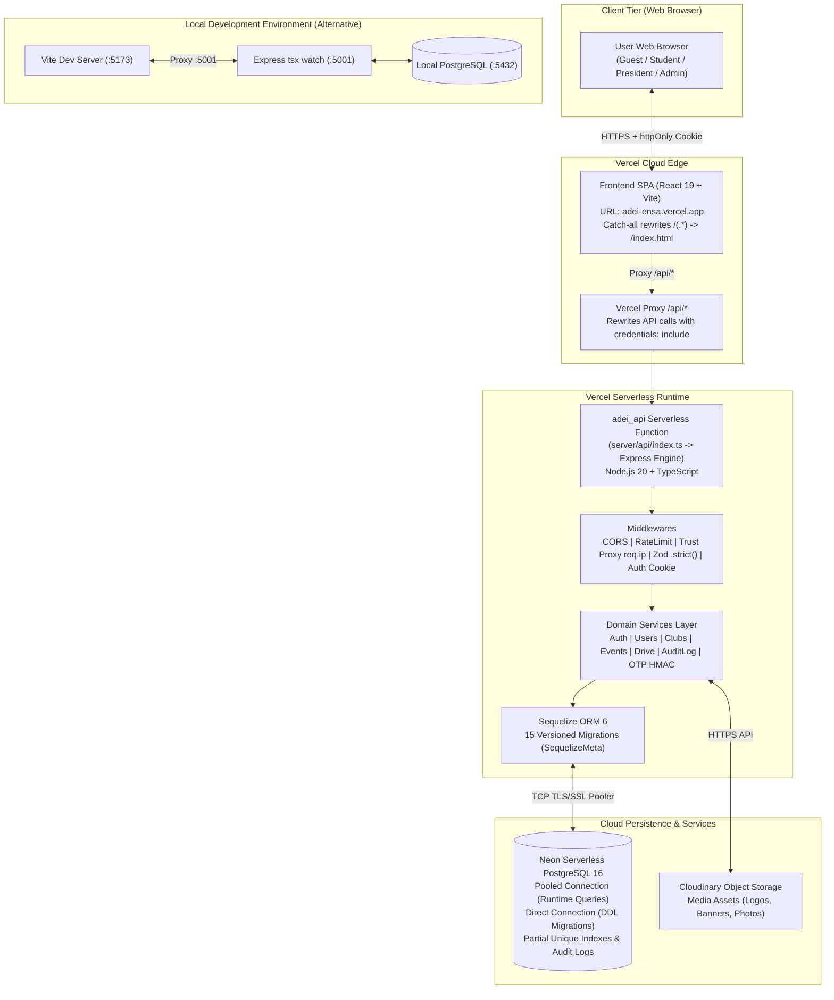

# ADEI Website — Complete Project Architecture & Concept Encyclopedia

> **Target Audience:** Developers learning full-stack engineering, system design, and production architecture.  
> **Project:** ADEI-Website (*Association des Étudiants Ingénieurs — ENSA Fès*)  
> **Tech Stack:** Vite 8 + React 19 + TypeScript · Node.js 20 & Express · Sequelize ORM · PostgreSQL 16 (Neon & Local) · Vercel Serverless

---

## 🗺️ High-Level System Architecture

---

## 🗺️ Master Engineering Roadmap: 14 Verifiable Jobs

> Each job ends with something verifiable (*Definition of Done*), ensuring clear progress and zero scope creep. Jobs 1 to 7 harden and structure the backend. Jobs 8 to 10 modernize the frontend and production deployment pipeline. Jobs 11 to 14 enforce cloud serverless deployment, migration baselines, CNDP regulatory compliance, and institutional audit logging.

### 📍 Phase Backend & Storage (Jobs 1–7)

* [x] **Job 1: Verify the PostgreSQL migration** *(COMPLETED ✅)*
  * *Goal:* Prove data survived without loss before any code restructuring.
  * *Tasks:*
    * [x] Compare row counts per table, MySQL vs PostgreSQL (Identical: 11 filières, 1 user)
    * [x] Check for orphaned foreign keys (`clubId`, `userId`) (0 orphaned keys)
    * [x] Insert one news item through the API (Sequence synchronization verified)
    * [x] Log in with an existing migrated user (JWT token received)
    * [x] Check dates and timezones on events/news (`GET /api/news` verified)
    * [x] Check that uploaded file paths (`/uploads/*`) still resolve (Static route active)
    * [x] Save a final mysqldump outside Docker as an immutable rollback point (`backups/final_mysql_rollback.sql`)
    * [x] Commit Phase 3 on its own git branch/commit
  * *Done when:* All checks pass and rollback point is secured.

* [x] **Job 2: Safety net (tests)** *(COMPLETED ✅)*
  * *Goal:* Know instantly when something breaks before refactoring Jobs 4–7.
  * *Tasks:*
    * [x] Export Express app from `server/app.js` (decoupled from `server/index.js` `listen()`)
    * [x] Create isolated `adei_test` PostgreSQL database with safety guard (`server/tests/setup.js`)
    * [x] Install `jest` + `supertest` as `devDependencies`
    * [x] Write 19 smoke tests (`server/tests/smoke.test.js`): health, 7 public GET routes, login, 401/403, News CRUD, 404, login rate limit (429)
    * [x] Document `npm test` in `README.md`
  * *Done when:* `docker compose exec api npm test` is 100% green (19/19 passed).

* [x] **Job 3: Small security fixes** *(COMPLETED ✅)*
  * *Goal:* Close remaining minor loopholes.
  * *Tasks:*
    * [x] Add `--reset` CLI flag to `server/scripts/createAdmin.js` (no silent password overwrite)
    * [x] Rotate legacy `password` admin credential
    * [x] Add `isPublished` moderation flag to `Feedback` model, PostgreSQL column, `GET /public` filter & `PUT /:id/publish` admin route
    * [x] Validate uploaded files by binary magic bytes (`file-type` + `validateUploadedFiles` middleware across all 5 upload routers)
    * [x] Migrate browser session auth from `localStorage` JWT to `httpOnly` cookie (`adei_token`) with `cookie-parser`, `withCredentials: true`, and `credentials: 'include'`
  * *Done when:* None of these remain open in notes and automated security tests pass (23/23).

* [x] **Job 4: Real migrations** *(COMPLETED ✅)*
  * *Goal:* Stop using `sequelize.sync()` in production.
  * *Tasks:*
    * [x] Configure `sequelize-cli` (`.sequelizerc` + `server/config/sequelize.config.js`)
    * [x] Replace legacy MySQL migrations with clean PostgreSQL baseline (`20261118000000-baseline-schema.js`)
    * [x] Remove `sequelize.sync()` from `server/index.js` boot
    * [x] Add `npm run migrate` & `npm run migrate:undo` scripts
  * *Done when:* A fresh empty database builds fully from migrations alone.

* [x] **Job 5: Backend structure** *(COMPLETED ✅)*
  * *Goal:* Routes only route; logic lives in controllers and services.
  * *Tasks:*
    * [x] Created `server/controllers/` and `server/services/` across all 9 domain modules
    * [x] Extracted cache invalidation (`news`, `events`) and club JSON parsing (`clubs`) into services
    * [x] Verified zero Sequelize queries remain in `server/routes/*.routes.js` & 23/23 tests green
  * *Done when:* No route file contains a raw Sequelize query.

* [x] **Job 6: Database redesign** *(COMPLETED ✅)*
  * *Goal:* Modernize relational model using migrations from Job 4.
  * *Tasks:*
    * [x] Reordering via `order_display` on `news` and `events` (no more swapping `createdAt`)
    * [x] Converted `clubs.activities` & `clubs.achievements` to native PostgreSQL `JSONB`
    * [x] Created `feedback_likes` unique join table + `POST /api/feedbacks/:id/like`
    * [x] Created `event_organizers` pivot table (multi co-organizers)
    * [x] Normalized `adei_roles` (`tier`, `position`) + `/api/adei-roles` CRUD
    * [x] Normalized academic hierarchy (`cycles` → `academic_years` → `sections`) + `/api/academic` API
  * *Done when:* Dashboard can edit all models with no hardcoded strings in frontend.

* [x] **Job 7: API contract and validation** *(COMPLETED ✅)*
  * *Goal:* One consistent, strongly typed API.
  * *Tasks:*
    * [x] Uniform response envelope (`server/utils/response.js`: `{ success, data, message?, meta? }` / `{ success: false, data: null, error }`) across all 11 controllers
    * [x] Zod validation schemas (`server/validators/schemas.js`) + reusable `validate()` middleware wired on all write routes
    * [x] Pagination (`server/utils/pagination.js` + prefix cache invalidation) on `news`, `events`, and `feedbacks`
    * [x] Updated React frontend (`api.js`, `AuthContext.jsx`, `ProtectedRoute.jsx`, `ADEI.jsx`, `UsersAdmin.jsx`) to consume the new envelope
  * *Done when:* Every endpoint returns the same shape and rejects invalid payloads with clear error details (26/26 tests green).

---

### 🎨 Phase Frontend & Cloud Deployment (Jobs 8–10)

* [x] **Job 8: TypeScript on the backend** *(COMPLETED ✅)*
  * *Goal:* Types derived directly from Zod schemas.
  * *Tasks:*
    * [x] Configured strict `tsconfig.json`, `tsx` dev hot-reload, `ts-jest`, and Express `req.user` declaration merging (`server/types/express.d.ts`)
    * [x] Converted `config/`, `utils/`, `middleware/`, `validators/` (`z.infer` types), all 14 `models/`, 11 `services/`, 11 `controllers/`, 11 `routes/`, `app.ts`, and `index.ts` to strict TypeScript
    * [x] Updated multi-stage `server/Dockerfile` to compile `tsc` into `dist/` for production
  * *Done when:* `tsc` builds the backend with zero type errors and 26/26 tests pass.

* [x] **Job 9: Frontend rebuild (`frontend/`)** *(COMPLETED ✅)*
  * *Goal:* Modern stack, page by page, with full shadcn/ui and enhanced feature set.
  * *Tasks:*
    * [x] Initialize Vite 8 + React 19 + TypeScript + Tailwind CSS v4 + Geist font in isolated `frontend-v2/`
    * [x] Install real `shadcn/ui` components (`base-nova` style with `@base-ui/react`): Button, Input, Textarea, Label, Card, Badge, Avatar, Separator, Dialog, Sheet, Tabs, Sonner
    * [x] Build typed API client (`apiRequest<T>`) handling uniform response envelope & `credentials: 'include'` for `httpOnly` cookies
    * [x] TanStack Query v5 & React Context: `AuthContext` (cookie `/users/me`) and `ThemeContext` (system / dark mode)
    * [x] Modern page redesign:
      * [x] `HomePage`: spotlight hero, asymmetric Bento grid, animated statistics, timeline preview
      * [x] `LoginPage`: cinematic split-screen with halo glow, password toggle, Sonner toasts
      * [x] `NewsPage` (Unified Feed): single URL `/news` with polymorphic toggle (`Tout`, `Actualités`, `Événements`), category filters, search, and detail modals (`/events` redirects to `/news?tab=events`)
      * [x] `ClubsPage`: interactive search, activity tags, contact badges, and detail modal
      * [x] `EnsaPage`: academic presentation, departments, and course curricula
      * [x] `AdeiPage`: multi-mandate historical archive (2025/2026, 2024/2025, 2023/2024...), 3-tier hierarchy (Présidence, Bureau Exécutif, Pôles)
      * [x] `FeedbacksPage`: interactive category cards, live character counter, community support likes, and Sonner feedback
      * [x] `ProfilePage`: live 8+ character password checklist, avatar, and role badges
      * [x] Admin Suite: `AdminLayout` SaaS sidebar, `AdminDashboardPage` with live counters, `ResourceAdminPage` with image previews, dropdown selects & mandate badges, and `FeedbacksAdminPage` with moderation tabs
    * [x] Seed realistic demo data (`server/scripts/seedDemo.ts` -> `npm run seed:demo`)
    * [x] User visual review and final approval of modern design
    * [x] Swap `frontend-v2/` -> `frontend/` and retire legacy CRA folder (port 3000)
  * *Done when:* User visually approves frontend and legacy Create React App folder is replaced.

* [x] **Job 10: Production deployment & CI/CD** *(COMPLETED ✅)*
  * *Goal:* Live, automated, and safe.
  * *Tasks:*
    * [x] Storage Abstraction (`server/services/storage.service.ts`): Strategy Pattern supporting local disk in dev (`STORAGE_PROVIDER=local`) and Cloudinary or S3/R2 in production, with graceful degradation.
    * [x] GitHub Actions CI/CD Pipeline (`.github/workflows/ci.yml`): automated multi-job workflow running PostgreSQL 16 container, backend TypeScript check (`tsc`), database migrations, 26 Jest smoke tests, and frontend Vite production bundle check on push & PR.
    * [x] SPA Deep Linking & URL Rewriting (`frontend/vercel.json`): catch-all rewrites (`/(.*) -> /index.html`) eliminating 404 errors on browser refresh.
    * [x] Managed Database & SSL Connection: enabled remote PostgreSQL connection string support (`DATABASE_URL`) and dynamic TLS/SSL dialect options for cloud hosts (Neon, Supabase, Railway, AWS RDS).
    * [x] Automated Database Disaster Recovery: backup script (`server/scripts/backupDatabase.ts` -> `npm run db:backup`) generating timestamped `pg_dump` archives into `backups/` with 30-day auto-purge.
  * *Done when:* Automated CI/CD workflow is wired, storage is abstracted for cloud deployment, and recovery procedures are documented.

---

### 🛡️ Phase Cloud Hardening, Privacy & Institutional Audit (Jobs 11–14)

* [x] **Job 11: Production Serverless Architecture & Vercel API Proxying** *(COMPLETED ✅)*
  * *Goal:* Deploy the Express API seamlessly on Vercel Serverless Functions with cross-origin cookie security and Neon database connection pooling.
  * *Tasks:*
    * [x] Create Vercel Serverless entry point [server/api/index.ts](file:///c:/Users/asus/Desktop/projects/ADEI-Website/server/api/index.ts) wrapping the Express app.
    * [x] Configure frontend Vercel rewrite proxy in [frontend/vercel.json](file:///c:/Users/asus/Desktop/projects/ADEI-Website/frontend/vercel.json) forwarding `/api/*` to the serverless API (`https://adei-api-phi.vercel.app`).
    * [x] Configure production cookie policy with `SameSite=None; Secure; httpOnly` for cross-origin credential transmission.
    * [x] Split database configuration: pooled connection via `DATABASE_URL` for high-concurrency runtime queries, and direct non-pooled connection for schema migrations.
  * *Done when:* The production SPA successfully communicates with the serverless backend on Vercel with authenticated cookies.

* [x] **Job 12: Production DDL Migration Baseline & Schema Isolation** *(COMPLETED ✅)*
  * *Goal:* Purge fragile runtime DDL schema manipulation from application boot and enforce strict, repeatable migrations.
  * *Tasks:*
    * [x] Remove runtime `sequelize.query(...)` schema repairs from [server/app.ts](file:///c:/Users/asus/Desktop/projects/ADEI-Website/server/app.ts).
    * [x] Author idempotent migration `20261126020000-event-registrations-and-organizers.js` (nullable `userId`, guest columns, `event_organizers` junction table).
    * [x] Apply partial unique indexes in PostgreSQL:
      * `(eventId, userId) WHERE userId IS NOT NULL`
      * `(eventId, guestEmail) WHERE userId IS NULL`
    * [x] Eliminate serverless cold-start race conditions and database locks.
  * *Done when:* `npm run migrate` runs cleanly on both fresh databases and live Neon instances without runtime schema monkey-patching.

* [x] **Job 13: CNDP Law 09-08 Privacy Compliance & OTP Security Hardening** *(COMPLETED ✅)*
  * *Goal:* Bring the platform into strict legal compliance with Moroccan data privacy law and protect OTP verification against brute-force attacks.
  * *Tasks:*
    * [x] Author migration `20261126030000-harden-otps-table.js` (widen `code` column to `VARCHAR(255)`, add `attempts INTEGER DEFAULT 0`).
    * [x] Implement salted cryptographic HMAC-SHA256 hashing for 6-digit OTP codes in [server/services/otp.service.ts](file:///c:/Users/asus/Desktop/projects/ADEI-Website/server/services/otp.service.ts) (never store plain codes in database).
    * [x] Enforce a 5-minute expiration window and a strict 5-attempt brute-force lockout.
    * [x] Add Moroccan CNDP Law 09-08 data protection notice and mandatory consent checkbox to the guest registration form on [frontend/src/pages/NewsPage.tsx](file:///c:/Users/asus/Desktop/projects/ADEI-Website/frontend/src/pages/NewsPage.tsx).
    * [x] Build centralized RFC 4180 CSV formula injection defense in [frontend/src/lib/csv.ts](file:///c:/Users/asus/Desktop/projects/ADEI-Website/frontend/src/lib/csv.ts) prefixing cells starting with `=`, `+`, `-`, `@`, `\t` with `'`.
    * [x] Enforce `.strict()` on Zod registration and guest schemas in [server/validators/schemas.ts](file:///c:/Users/asus/Desktop/projects/ADEI-Website/server/validators/schemas.ts).
    * [x] Enforce roster tenant isolation: Club 1 president cannot view Club 2 roster (returns 403 Forbidden).
  * *Done when:* All OTP and permission integration tests pass (guest double-registration returns 400, roster cross-access returns 403).

* [x] **Job 14: Institutional Audit Logging & Governance Trail** *(COMPLETED ✅)*
  * *Goal:* Provide an immutable, tamper-evident audit log for all institutional and administrative actions.
  * *Tasks:*
    * [x] Author migrations `20261126040000-create-audit-logs.js` and `20261126050000-harden-audit-logs.js` creating the `audit_logs` table with actor snapshots (`actorEmail`, `actorRole`) and foreign key `ON DELETE SET NULL`.
    * [x] Create [server/models/AuditLog.ts](file:///c:/Users/asus/Desktop/projects/ADEI-Website/server/models/AuditLog.ts), [server/services/audit.service.ts](file:///c:/Users/asus/Desktop/projects/ADEI-Website/server/services/audit.service.ts), [server/controllers/audit.controller.ts](file:///c:/Users/asus/Desktop/projects/ADEI-Website/server/controllers/audit.controller.ts), and [server/routes/audit.routes.ts](file:///c:/Users/asus/Desktop/projects/ADEI-Website/server/routes/audit.routes.ts).
    * [x] Remove client-side `POST /api/audit/log-export`. Implement server-side `ROSTER_EXPORT` auditing in [server/controllers/events.controller.ts](file:///c:/Users/asus/Desktop/projects/ADEI-Website/server/controllers/events.controller.ts) with real attendee count.
    * [x] Enforce fail-closed semantics: fail the entire request if audit log writes fail on critical actions (`ROSTER_EXPORT`, `USER_STATUS_UPDATE`, role modifications).
    * [x] Isolate client IP extraction strictly through Express `req.ip` with `trust proxy` configured.
    * [x] Instrument lifecycle events: `LOGIN_SUCCESS`, `LOGIN_FAILURE`, `PASSWORD_CHANGE`, `USER_DELETE`, `CLUB_DELETE`, `EVENT_DELETE`, `FEEDBACK_DELETE`.
    * [x] Build administrative audit log viewer at [frontend/src/pages/admin/AdminAuditLogsPage.tsx](file:///c:/Users/asus/Desktop/projects/ADEI-Website/frontend/src/pages/admin/AdminAuditLogsPage.tsx) (`/admin/audit-logs`) with search wildcard escaping (`%`, `_`), capped at 100 rows, and self-auditing `AUDIT_LOGS_VIEW`.
  * *Done when:* Integration tests pass verifying non-admin 403, fail-closed write semantics, and actor snapshot preservation.

---

---

## 📁 1. Project Root Directory

The root directory coordinates development environments, container orchestration, environment security, and deployment pipelines.

### Root Files & Folders

#### `docker-compose.yml`
* **What it does:** The declarative multi-container orchestrator. It defines and runs 5 isolated containers (`mysql`, `postgres`, `adminer`, `api`, `frontend`) connected on a shared private bridge network (`adei_network`), configuring port mappings, health checks, environment forwarding, and persistent volume storage.
* **Core Concepts to Search & Study:**
  * `Container Orchestration` (Docker Compose v2 specification)
  * `Bridge Networking` (isolated DNS resolution by service name e.g. `host: mysql`)
  * `Bind Mounts vs Named Volumes` (`./server:/app` for live code vs `mysql_data` for database durability)
  * `Healthcheck & Service Dependencies` (`condition: service_healthy` preventing the API from starting before MySQL is ready)
  * `Environment Variable Substitution` (`${API_PORT:-5001}`)

#### `.env` *(Gitignored)* & `.env.example` *(Tracked)*
* **What it does:** `.env` contains the live credentials and configuration for the local machine (passwords, JWT secrets, ports). `.env.example` is the committed template listing all required variables with placeholder values.
* **Core Concepts to Search & Study:**
  * `Twelve-Factor App (Config principle)`: Storing config in the environment, separated from code.
  * `Secret Sprawl & Git Hygiene`: Why credentials must never enter version control history.
  * `Placeholder Templates`: Standardizing team onboarding without sharing plain-text secrets.

#### `.gitignore`
* **What it does:** Instructs Git which files and directories to ignore from tracking (e.g. `node_modules/`, `.env*`, `*.sql`, `server/uploads/`, `build/`).
* **Core Concepts to Search & Study:**
  * `Repository Bloat`: Preventing massive dependency trees and binary files from slowing down git trees.
  * `Security Whitelisting vs Blacklisting` in git patterns.

#### `README.md`
* **What it does:** The developer onboarding manual. Explains prerequisites, steps to boot with Docker, database restore instructions from `./backups`, default port table, and administrator creation commands.
* **Core Concepts to Search & Study:**
  * `Self-Documenting Codebases` & `Developer Experience (DX)`.

#### `backups/` & `backups/.gitkeep`
* **What it does:** A directory where raw MySQL `.sql` backup dumps are placed. It is bind-mounted directly into the MySQL container at `/backups` so database dumps can be restored with a single terminal command. `.gitkeep` ensures the folder exists in Git without tracking the heavy `.sql` dumps.
* **Core Concepts to Search & Study:**
  * `Database Restoration & Dump Ingestion` (`mysql < dump.sql`)
  * `Git Empty Directory Retention` (the `.gitkeep` convention)

---

## 📁 2. Backend Server (`/server`)

The backend is an Express.js REST API providing secure endpoints for authentication, content management (news, events, clubs, partners, filières), feedback collection, and file storage.

### Root Server Files

#### `server/Dockerfile`
* **What it does:** A multi-stage Docker build recipe. Defines a `base` stage (`node:20-alpine`), a `dev` stage (mounts source code with `nodemon`), a `prod-deps` stage (installs only production npm packages), and a `production` stage running as a secure, unprivileged non-root user (`node`).
* **Core Concepts to Search & Study:**
  * `Multi-Stage Builds`: Keeping final production images tiny by leaving build tools behind.
  * `Principle of Least Privilege`: Running processes as non-root `UID 1000` rather than `root` to prevent container-breakout vulnerabilities.
  * `Docker Layer Caching`: Copying `package.json` before code so `npm install` only re-runs when dependencies change.

#### `server/.dockerignore`
* **What it does:** Prevents copying the host machine's `node_modules`, `.env`, and local logs into the Docker build context.
* **Core Concepts to Search & Study:**
  * `Build Context Optimization` in Docker.

#### `server/package.json` & `server/package-lock.json`
* **What it does:** Declares backend dependencies (`express`, `sequelize`, `mysql2`, `bcryptjs`, `jsonwebtoken`, `multer`, `cors`, `express-rate-limit`, `dotenv`, `nodemon`) and lifecycle scripts (`npm run dev`, `npm start`).
* **Core Concepts to Search & Study:**
  * `Semantic Versioning (SemVer)` (`^` vs `~` vs exact versions).
  * `Deterministic Builds` via `package-lock.json`.

#### `server/index.js` *(Orchestrator & Bootstrap)*
* **What it does:** The main entry point. Initializes Express, configures CORS, serves static uploaded files (`/uploads`), connects and synchronizes Sequelize with MySQL, mounts all 9 domain routers, registers the centralized error handler and 404 catch-all, and begins listening on `PORT 5001`.
* **Core Concepts to Search & Study:**
  * `Application Bootstrap Pattern`: Keeping `index.js` thin as an orchestrator rather than packing routes into it.
  * `Middleware Pipeline & Execution Order`: Why body parsers come first, routers in the middle, and error handlers at the very bottom.
  * `Reverse Proxy Trust` (`app.set('trust proxy', 1)`): Allowing Express to read client IPs through `X-Forwarded-For`.
  * `Graceful Connection Retry` (`connectWithRetry()`): Retrying database connections on network boot delays.

---

### Backend Modules (`/server/config`)

#### `server/config/env.js`
* **What it does:** Validates and freezes all environment configuration on boot. Checks that `JWT_SECRET` is at least 32 characters, database connection variables are present, and `CORS_ORIGINS` is set in production. Shuts down immediately with a clear error message if any variable is missing or invalid (**Fail-Fast Principle**).
* **Core Concepts to Search & Study:**
  * `Fail-Fast Principle`: Halting execution at startup rather than encountering silent or delayed runtime crashes.
  * `Immutable Configuration Objects` (`Object.freeze`): Preventing code from accidentally mutating configuration at runtime.

#### `server/config/database.js`
* **What it does:** Instantiates the Sequelize ORM connection pool to MySQL using environment variables (`DB_HOST`, `DB_PORT`, `DB_NAME`, `DB_USER`, `DB_PASSWORD`).
* **Core Concepts to Search & Study:**
  * `Object-Relational Mapping (ORM)`: Translating SQL tables and rows into JavaScript classes and objects.
  * `Connection Pooling`: Reusing database TCP sockets (`max: 5`, `min: 0`, `acquire: 30000`, `idle: 10000`) instead of opening a new handshake on every query.

#### `server/config/upload.js`
* **What it does:** Configures `multer` for multipart form data uploads. Restricts upload sizes to 10 MB, enforces strict MIME and extension whitelisting (images & docs), and exposes `safeDeleteUpload(fileUrl)` to delete old files without risking directory traversal.
* **Core Concepts to Search & Study:**
  * `Multipart Form-Data Handling`: How binary files are parsed over HTTP.
  * `MIME Type Sniffing & Validation`: Rejecting `.exe` or executable scripts disguised as images.
  * `Path Traversal / Directory Traversal Vulnerability`: Using `path.resolve` and verifying `resolvedPath.startsWith(UPLOAD_DIR)` to prevent malicious deletion of `/etc/passwd` or system files via `../../`.

---

### Backend Modules (`/server/middleware`)

#### `server/middleware/auth.js`
* **What it does:** Provides `authMiddleware` (validates incoming JWT tokens from `Authorization: Bearer <token>` and attaches `req.user`) and `adminMiddleware` (verifies `req.user.role === 'admin'`).
* **Core Concepts to Search & Study:**
  * `Stateless Authentication`: Verifying identity cryptographically via JWT without querying a session table.
  * `Role-Based Access Control (RBAC)`: Guarding sensitive endpoints based on user roles (`admin` vs `user`).
  * `Token Verification & Expiration`: Handling invalid, expired, or tampered signatures.

#### `server/middleware/errorHandler.js`
* **What it does:** Provides `asyncWrapper` (catches unhandled async errors and forwards them to Express), `errorMiddleware` (central 4-argument Express error handler translating Multer, JSON syntax, and database errors into clean JSON), and `notFoundMiddleware` (`404 NOT_FOUND`).
* **Core Concepts to Search & Study:**
  * `Express Centralized Error Handling`: The special `(err, req, res, next)` 4-argument signature.
  * `Async Error Forwarding`: Why unhandled Promise rejections crash Node unless caught or wrapped.
  * `Information Leakage Prevention`: Never returning raw stack traces to the public in production.

---

### Backend Modules (`/server/models`)

#### `server/models/index.js`
* **What it does:** Central model registry. Loads and exports all models, and defines database relationships (e.g. `Club.hasMany(News)`, `Club.hasMany(Event)`).
* **Core Concepts to Search & Study:**
  * `Relational Data Modeling`: Primary keys, foreign keys (`clubId`), and cascade behavior.
  * `Sequelize Associations`: `hasMany`, `belongsTo`, and eager-loading (`include: [...]`).

#### `server/models/User.js`
* **What it does:** Database schema for users. Stores `username`, `email` (unique), `password` (hashed, validated with a minimum length of 8 characters), `role` (`'user'` or `'admin'`), badge flags (`is_president`, `is_bureau_adei`, etc.), and `lastPasswordChange`.
* **Core Concepts to Search & Study:**
  * `Model-Level Validation`: Using Sequelize's built-in `validate: { len: [8, 255] }` constraint to enforce business rules before SQL execution.
  * `Salted Password Hashing`: Why raw passwords are never saved and must be hashed with bcrypt.
  * `Enumerated Types (ENUM)` in SQL.

#### `server/models/News.js` & `server/models/Event.js`
* **What it does:** Schemas for campus news articles and events. Track titles, descriptions, dates, category tags, organizer name, foreign key `clubId`, and uploaded file paths (`image`, `document`).
* **Core Concepts to Search & Study:**
  * `Foreign Key Constraints`: Linking news and events to the organizing student club.

#### `server/models/Club.js`
* **What it does:** Schema for student technical/cultural clubs. Stores president details, contact info, social links, and serialized JSON text for `activities` and `achievements`.
* **Core Concepts to Search & Study:**
  * `JSON Serialization in SQL Text Columns`: Storing structured lists in standard MySQL text fields.

#### `server/models/Feedback.js`
* **What it does:** Schema for anonymous or user-submitted suggestions/issues. Stores message content, feedback category (`'suggestion'`, `'bug'`, `'autre'`), and optional `userId`.
* **Core Concepts to Search & Study:**
  * `Optional Relational Links`: Supporting both guest submissions and authenticated user submissions.

#### `server/models/Filiere.js`
* **What it does:** Schema for engineering degree tracks (e.g. `3IACN`, `GDNC`, `ISDIA`, `CPI`). Tracks degree name, abbreviation, contact info for class delegates, syllabus PDF link, and display sort order.
* **Core Concepts to Search & Study:**
  * `Ordered Entity Sorting`: Using `order_display` for manual reordering in UI dashboards.

#### `server/models/ADEIMember.js` & `server/models/Partner.js`
* **What it does:** Schemas for ADEI executive bureau members and corporate sponsors/partners. Stores names, executive roles, photos, sponsor logos, and website links.

---

### Backend Modules (`/server/routes`)

#### `server/routes/auth.routes.js`
* **What it does:** Public authentication endpoints: `POST /api/login` (rate-limited, verifies bcrypt password, issues 24-hour signed JWT) and `POST /api/logout`.
* **Core Concepts to Search & Study:**
  * `Brute-Force Protection`: Using `express-rate-limit` to restrict attempts to 20 per 15 minutes.
  * `JWT Signature Generation`: `jwt.sign(payload, secret, { expiresIn: '24h' })`.

#### `server/routes/users.routes.js`
* **What it does:** User self-management (`GET /api/users/me`, `GET /password-security`, `POST /change-password`) and admin user management (CRUD). Protects against deleting the last remaining admin.
* **Core Concepts to Search & Study:**
  * `Data Projection / Exclude Queries`: `attributes: { exclude: ['password'] }` so hashes are never returned.
  * `Business Rule Invariants`: Guarding critical system states (preventing admin lockout).

#### `server/routes/news.routes.js` & `server/routes/events.routes.js`
* **What it does:** Public read endpoints with 30-second in-memory caching (`GET /api/news`, `GET /api/events`), admin CRUD with dual uploads (`upload.fields`), and chronological reordering (`PATCH /:id/reorder`).
* **Core Concepts to Search & Study:**
  * `Read Caching & Cache Invalidation`: Storing queries in memory and evicting with `clearCache()` on create/update/delete.
  * `Chronological Date Swapping`: Swapping `createdAt` timestamps to reorder items in ordered feeds.

#### `server/routes/clubs.routes.js`
* **What it does:** Handles clubs listing and management. Automatically deserializes `activities` and `achievements` from JSON/strings into native JavaScript arrays for the frontend, and handles club logo uploads.
* **Core Concepts to Search & Study:**
  * `Data Transformation Layer (DTO / Serializer)`: Adapting database representation to client API contracts.

#### `server/routes/filieres.routes.js`
* **What it does:** Endpoints for engineering filières. Handles validation errors (`SequelizeUniqueConstraintError`, `SequelizeValidationError`) and filters active filières for the student portal.
* **Core Concepts to Search & Study:**
  * `Error Specialization`: Mapping specific database constraint errors to human-readable 400 responses.

#### `server/routes/feedbacks.routes.js`
* **What it does:** Handles public read of testimonials (`/public`), admin full detail access, spam-limited submission (`POST /` protected by `feedbackLimiter`), and marking feedbacks as read.
* **Core Concepts to Search & Study:**
  * `Soft State Updates`: Toggling boolean flags (`read: true`) without deleting data.

#### `server/routes/partners.routes.js` & `server/routes/adeiMembers.routes.js`
* **What it does:** Partner sponsors and bureau members. Handles single file uploads (`upload.single('logo')`, `upload.single('photo')`), safe file replacement on updates, and partner manual ordering (`PATCH /:id/reorder`).

---

### Backend Utilities & Scripts (`/server/utils` & `/server/scripts`)

#### `server/utils/cache.js`
* **What it does:** A lightweight in-memory cache backed by a JavaScript `Map`. Stores cached responses for 30,000ms (30 seconds) and provides `getCachedData`, `setCachedData`, and `clearCache`.
* **Core Concepts to Search & Study:**
  * `In-Memory Caching (TTL Pattern)`: Time-to-live caching to reduce database read load.
  * `Cache Coherence & Eviction`: Ensuring mutations purge stale cached data immediately.

#### `server/utils/sanitize.js`
* **What it does:** Whitelist dictionary (`ALLOWED_FIELDS`) and `pickFields(body, type)` helper that extracts only explicitly permitted fields from request bodies.
* **Core Concepts to Search & Study:**
  * `Mass Assignment Vulnerability / Over-Posting`: Preventing malicious users from injecting unauthorized fields (e.g. `role: 'admin'`, `id: 5`) into ORM create/update calls.

#### `server/scripts/createAdmin.js`
* **What it does:** A secure CLI maintenance script to create or synchronize an administrator account. Reads `ADMIN_USERNAME`, `ADMIN_EMAIL`, and `ADMIN_PASSWORD` from `.env`, enforces a 12-character minimum password policy, and safely synchronizes/resets the admin's email and password hash if the account already exists (idempotent upsert).
* **Core Concepts to Search & Study:**
  * `CLI Database Seeding & Maintenance Scripts`
  * `Idempotence`: An operation that produces the exact same result no matter how many times it is executed.
  * `Credential Recovery / CLI Password Reset`: How DevOps engineers reset administrator credentials securely via container execution without touching raw database tables.

#### `server/scripts/seedFilieres.js`
* **What it does:** One-time database seeder that populates all 11 ENSA engineering filières and prepa classes with initial curricula and delegate placeholders.
* **Core Concepts to Search & Study:**
  * `Database Seeding & Fixtures`.

#### `server/scripts/migrateMysqlToPostgres.js`
* **What it does:** Enterprise ETL (Extract, Transform, Load) script that migrates data table-by-table from MySQL to PostgreSQL. Connects simultaneously to both databases, enforces strict topological dependency ordering (parents before children), converts boolean representations, preserves primary keys with `ignoreDuplicates`, and resets PostgreSQL auto-increment sequences via `setval()`.
* **Core Concepts to Search & Study:**
  * `ETL (Extract, Transform, Load) Pipelines`: How heterogeneous data stores synchronize and migrate.
  * `Topological Sorting in Relational Databases`: Why parents (users, clubs) must precede children (news, events, feedbacks) to satisfy foreign key constraints.
  * `PostgreSQL Sequences & setval()`: Why explicit ID inserts require manual sequence synchronization in PostgreSQL.

---

## 📁 3. Frontend Architecture: Modern Single-Page Application (`/frontend`)

The project uses a modernized, high-performance SPA running on port `5173` in local development (Vite HMR), port `3000` via Docker Compose, and deployed globally on Vercel Edge.

### 🌟 Modern Frontend (`/frontend`)

Built with **Vite 8**, **React 19**, **TypeScript**, **Tailwind CSS v4**, **shadcn/ui**, **TanStack Query v5**, **Framer Motion**, and **Geist Variable Font**.

#### Root Files & Configuration
* **`frontend/vite.config.ts`:** Vite 8 configuration with `@tailwindcss/vite` plugin and `@` path alias mapped to `frontend/src/`.
* **`frontend/tsconfig.json` & `tsconfig.app.json`:** Strict TypeScript configuration with `verbatimModuleSyntax`, `erasableSyntaxOnly`, and path aliases.
* **`frontend/index.html`:** Clean HTML5 entry point mounting the React root and importing the Geist font family.
* **`frontend/vercel.json`:** SPA catch-all rewrite rule (`/(.*) -> /index.html`) to prevent 404s on browser reload, plus `/api/*` proxy rewrite to `https://adei-api-phi.vercel.app`.

#### Client Core (`frontend/src/lib` & `context`)
* **`frontend/src/lib/api.ts`:** Typed HTTP client function `apiRequest<T>()`. Configures `credentials: 'include'` for automatic `httpOnly` cookie transfer, parses the standardized `{ success, data, meta, error }` response envelope, and provides `getImageUrl()`.
* **`frontend/src/lib/csv.ts`:** Centralized RFC 4180 CSV serializer and formula injection defense. Escapes delimiter commas, quotation marks, and prefixes cells starting with `=`, `+`, `-`, `@`, `\t` with `'` to prevent DDE code execution in Microsoft Excel.
* **`frontend/src/context/AuthContext.tsx`:** Manages global authentication session by fetching `/api/users/me` on startup. Zero local storage token leaks.
* **`frontend/src/context/ThemeContext.tsx`:** Manages light/dark themes with system preference synchronization and persistent class toggles.

#### Design System & shadcn/ui (`frontend/src/components/ui/`)
* Contains accessible, modular `shadcn/ui` components (`base-nova` style with `@base-ui/react`):
  * `avatar.tsx`, `badge.tsx`, `button.tsx`, `card.tsx`, `dialog.tsx`, `input.tsx`, `label.tsx`, `separator.tsx`, `sheet.tsx`, `sonner.tsx`, `tabs.tsx`, `textarea.tsx`.

#### Redesigned Public & Student Pages (`frontend/src/pages/`)
* **`HomePage.tsx`:** Spotlight hero with gradient backdrop, asymmetric Bento grid, live animated counters, chronological timeline events, and Boîte à Idées CTA.
* **`LoginPage.tsx`:** Cinematic split-screen with radial halo glow, show/hide password toggle, and Sonner toast error handling.
* **`RegisterPage.tsx`:** Student onboarding with academic hierarchy selectors (cycle, year, filière) and mandatory CNDP privacy consent.
* **`VerifyOtpPage.tsx` & `ResetPasswordPage.tsx`:** Secure 6-digit OTP entry with real-time attempt tracking and password recovery.
* **`NewsPage.tsx` (Unified Feed):** Consolidates news and events under a single intuitive route (`/news`), featuring a polymorphic toggle (`Tout`, `Actualités`, `Événements`), category pills, search bar, and full detail modals. Includes external guest event RSVP with CNDP Law 09-08 consent.
* **`ClubsPage.tsx`:** Student club directory with interactive activity and achievement tags, search filtering, president contacts, and detail popup dialogs.
* **`ClubPresidentPage.tsx`:** Restricted portal for verified club presidents to oversee club events, inspect attendee counts, and safely export CSV rosters.
* **`EnsaPage.tsx`:** School presentation, degree tracks, and academic curricula with accessible tabs.
* **`AdeiPage.tsx`:** Student council showcase with a **dynamic multi-mandate switcher** (`2025/2026`, `2024/2025`, `2023/2024`...) and a 3-tier visual hierarchy (Présidence, Bureau Exécutif, Pôles & Responsables).
* **`FeedbacksPage.tsx`:** Interactive Boîte à Idées with category selection cards, live character counter, community support/like buttons, and Sonner toasts.
* **`ProfilePage.tsx`:** User profile with assigned role badges, account details, and live 8+ character password checklist.

#### Administrative Console (`frontend/src/pages/admin/`)
* **`AdminLayout.tsx`:** Responsive SaaS administrative sidebar with icon groups, active indicator pills, and return link to the public portal.
* **`AdminDashboardPage.tsx`:** Real-time administrative overview with animated KPI stat cards for all platform resources.
* **`AdminAuditLogsPage.tsx`:** Institutional audit log inspection dashboard (`/admin/audit-logs`) featuring live actor badges, search wildcard escaping, metadata JSON inspection, and self-audited viewing trails.
* **`ResourceAdminPage.tsx`:** Universal CRUD controller supporting file uploads (with thumbnail previews), dropdown selects, reordering, and search filtering across news, events, clubs, filières, partners, ADEI members, and users.
* **`FeedbacksAdminPage.tsx`:** Moderation center with `En attente`, `Publiés`, and `Tous` tabs, allowing one-click publishing, hiding, and spam deletion.

---

### 📦 Build & Containerization

#### `frontend/Dockerfile` & `frontend/.dockerignore`
* **What it does:** Builds the production Vite bundle using Node.js 20, serving the static assets with minimal overhead and providing live HMR polling when running in Docker Compose on Windows.
* **Core Concepts to Search & Study:**
  * `CHOKIDAR_USEPOLLING / WATCHPACK_POLLING`: Workaround for file-system events across Windows-to-Linux Docker bind mounts.
  * Multi-Stage Builds: Compiling TypeScript/Vite in a build container, discarding development dependencies in the final image.

#### `frontend/package.json`
* **What it does:** Defines frontend dependencies (`react`, `react-dom`, `react-router-dom`, `framer-motion`, `lucide-react`, `axios`) and CRA scripts.

#### `frontend/src/index.js`
* **What it does:** React application root. Mounts `<App />` into the DOM element `
` using React 19's `createRoot` API.
* **Core Concepts to Search & Study:**
  * `Virtual DOM Mounting & Concurrent React`.

#### `frontend/src/App.jsx`
* **What it does:** The client routing hub. Wraps the app in `ThemeProvider` and `AuthProvider`, defines all public routes (`/`, `/news`, `/events`, `/clubs`, `/filieres`, `/login`, etc.), and wraps `/admin/*` routes in `<ProtectedRoute requiredRole="admin">`.
* **Core Concepts to Search & Study:**
  * `Declarative Client-Side Routing`: Handling navigation without browser page reloads.
  * `Route Guards & Higher-Order Components (HOC)`.

#### `frontend/src/AuthContext.jsx`
* **What it does:** Global authentication state provider. Manages `user`, `token`, `login()`, `logout()`, stores JWT tokens in `localStorage`, and keeps auth state persistent across browser refreshes.
* **Core Concepts to Search & Study:**
  * `React Context API`: Avoiding "prop drilling" by sharing user session state across the component tree.
  * `Client Storage (localStorage)`: Storing authentication tokens on the client.

#### `frontend/src/config/api.js`
* **What it does:** Centralized Axios HTTP client. Sets `baseURL` to `http://localhost:5001/api` and attaches an Axios request interceptor that automatically injects `Authorization: Bearer <token>` into outgoing requests.
* **Core Concepts to Search & Study:**
  * `HTTP Interceptors`: Automatically modifying requests (injecting headers) before they leave the browser.

#### `frontend/src/contexts/ThemeContext.jsx`
* **What it does:** Manages dark/light theme switching by toggling `theme-dark` or `theme-light` classes on `document.documentElement` and persisting preferences in `localStorage`.
* **Core Concepts to Search & Study:**
  * `Theme Switching with CSS Variables`: Modifying root tokens (`--bg-primary`, `--text-primary`) dynamically.

---

### Frontend Components (`/frontend/src/components`)

* **`ModernNavbar.jsx` & `NavIcons.jsx`:** Main navigation bar with responsive mobile hamburger drawer, active link indicators, and admin panel shortcut button.
* **`Footer.jsx`:** Site footer with school contact information, social links, and ADEI credits.
* **`ProtectedRoute.jsx`:** Security barrier component. Inspects `useAuth()`. If the user is unauthenticated or not an admin, immediately redirects to `/login`.
* **`AdminNavigation.jsx`:** Side/top navigation tab system for switching between admin management sections (News, Events, Clubs, Filières, Feedbacks, Users, Partners, Members).
* **`DetailsModal.jsx`:** Reusable animated popup modal dialog for viewing event/club details.
* **`ErrorBoundary.jsx`:** React error boundary that catches component rendering crashes and displays a recovery fallback rather than a blank white screen.
* **`FloatingThemeToggle.jsx`:** Animated floating button to toggle light and dark modes.

---

### Specialized UI Widgets (`/frontend/src/components/ui`)

* **`AnimatedClubs.jsx`:** Interactive carousel/grid of campus clubs powered by Framer Motion.
* **`ImageUpload.jsx`:** Reusable drag-and-drop file upload picker with client-side image preview before form submission.
* **`MembersOrgChart.jsx`:** Visual organizational chart showcasing ADEI executive bureau members.
* **`Typewriter.jsx`:** Animated typewriter text effect for landing page hero headlines.
* **`UserBadges.jsx`:** Renders role and responsibility badges (e.g. *"Président Club"*, *"Membre Bureau ADEI"*, *"Admin"*).

---

### Frontend Public Pages (`/frontend/src/pages`)

* **`Home.jsx`:** Main landing page featuring the hero section, quick news summary, upcoming events preview, club highlights, and call-to-action cards.
* **`News.jsx`:** Campus news timeline with search filtering, category tags, and PDF document download links.
* **`Events.jsx`:** Campus events agenda with calendar view, location maps, organizer tags, and detail popups.
* **`Clubs.jsx`:** Directory of student clubs displaying logos, president contacts, social links, and lists of past achievements.
* **`ENSA.jsx`:** Presentation page of the National School of Applied Sciences of Fez, its engineering history, and departments.
* **`ADEI.jsx`:** Presentation page of the student council (*Association des Étudiants Ingénieurs*), its mission, and bureau members.
* **`Feedbacks.jsx`:** Student feedback portal where students can submit anonymous suggestions or read public community reviews.
* **`Login.jsx`:** Authentication form with email/password validation, error message toasts, and automatic redirect upon successful login.
* **`Profile.jsx`:** User profile page displaying account details, assigned student badges, and a password change form.

---

### Frontend Admin Pages (`/frontend/src/pages/admin`)

* **`AdminDashboard.jsx`:** Central administrative overview with quick statistics (total clubs, active news, pending feedbacks, user counts).
* **`NewsAdmin.jsx` & `EventsAdmin.jsx`:** Administrative management tables for news and events: create new posts, upload photos and PDFs, edit existing entries, delete, and reorder.
* **`ClubsAdmin.jsx`:** Management page to create and edit student clubs, manage activities, and update social links.
* **`FilieresAdmin.jsx`:** Degree track management page to update department heads, student delegates, documentation links, and active visibility.
* **`FeedbacksAdmin.jsx`:** Feedback inbox for administrators to review submitted student messages, mark them as read, or delete spam.
* **`UsersAdmin.jsx`:** Administrator user management page to create accounts, assign roles (`admin` vs `user`), and toggle special council badges.
* **`ADEIMembersAdmin.jsx` & `PartnersAdmin.jsx`:** Management pages for council executive members and corporate partner logos.

---

## 📚 4. Master Search Glossary: Concepts for Further Learning

Use these exact terms in Google, YouTube, or documentation searches to master the concepts used across this repository:

### 1. Backend & Systems Architecture
* **`Express.js Router Modularization`**: How `express.Router()` splits massive web apps into scalable sub-modules.
* **`Middleware Pattern in Node.js`**: How request pipelines work and how to write custom interception logic.
* **`Centralized Error Handling Express`**: How 4-argument error middlewares standardize API error contracts.
* **`Reverse Proxy and X-Forwarded-For`**: Why `app.set('trust proxy', 1)` is required behind Cloudflare, Nginx, or Traefik.
* **`Fail-Fast Principle Software Design`**: Why critical configurations (e.g. environment variables) must halt booting if invalid.

### 2. Security & Authentication
* **`JSON Web Token (JWT) Authentication Flow`**: The anatomy of Header, Payload, Signature, and stateless session verification.
* **`Password Hashing with Bcrypt and Salt Rounds`**: Why passwords cannot be reversed and how salting defends against rainbow tables.
* **`Cross-Origin Resource Sharing (CORS) Deep Dive`**: Preflight `OPTIONS` requests, Origin header validation, and credential security.
* **`Mass Assignment Vulnerability Prevention`**: Why passing raw `req.body` directly to database models is dangerous.
* **`API Rate Limiting & Leaky Bucket Algorithm`**: How to prevent brute-force credential stuffing and denial of service.
* **`Path Traversal (Directory Traversal) Security`**: Protecting file storage endpoints against `../` path injections.

### 3. Databases & ORM
* **`Object-Relational Mapping (ORM) Patterns`**: Comparing raw SQL to Sequelize models and query builders.
* **`Database Connection Pooling`**: Why connections are maintained in a pool instead of created per HTTP request.
* **`Database Idempotency & Seeding`**: Writing scripts that can be safely run multiple times without duplicating data.
* **`MySQL to PostgreSQL Migration Strategies`**: Differences between MySQL types and Postgres types (`ENUM` vs `VARCHAR`, `TEXT` vs `JSONB`).

### 4. DevOps & Containerization
* **`Docker Multi-Stage Builds`**: Optimizing container sizes by separating compile-time and runtime environments.
* **`Non-Root Container Security`**: Why production containers should run as unprivileged users (`node:1000`).
* **`Docker Compose Networking & Service Discovery`**: How containers resolve each other over internal DNS names.
* **`Bind Mounts vs Volumes in Docker`**: Developing with hot-reload (`bind mount`) vs persistent database storage (`named volume`).

### 5. Frontend & React
* **`Single Page Application (SPA) Routing`**: How HTML5 History API handles navigation without page reloads.
* **`React Context API & State Management`**: Providing global state (Authentication, Themes) without prop drilling.
* **`Axios Request & Response Interceptors`**: Automatically attaching bearer tokens and intercepting 401 Unauthorized responses.
* **`React Error Boundary Pattern`**: Catching JavaScript rendering exceptions and presenting fallback user interfaces.
* **`CSS Custom Properties (Variables) Theming`**: Implementing system-wide light/dark themes in pure CSS.

---

## 🧠 6. Concepts Vus en Pratique (À Réviser Plus Tard) / Concepts Encountered in Practice

> **Journal d'apprentissage & Fiches Mémo :** Cette section recense tous les concepts concrets, architecturaux et de sécurité que nous avons manipulés ensemble lors de nos sessions de refactorisation. Vous pourrez y revenir pour approfondir chaque notion à votre rythme pour vos entretiens, projets ou examens.

### 🗄️ Architecture & Données (Phases 1 & 3)

* **`Parallel Run (Fonctionnement en Parallèle)`** :
  * **Ce que c'est :** Faire tourner deux moteurs de bases de données (MySQL 8.0 et PostgreSQL 16) simultanément dans le même réseau Docker.
  * **Pourquoi :** Permet de migrer les données, tester la conformité et basculer le trafic sans aucune interruption de service (*zero downtime*) tout en conservant une possibilité de retour en arrière instantané (*rollback*).

* **`ETL (Extract, Transform, Load)`** :
  * **Ce que c'est :** Le processus industriel qui extrait les données brutes d'une source (MySQL), transforme les types incompatibles (ex: convertir les `1`/`0` de MySQL en vrais `true`/`false` pour le type `BOOLEAN` strict de Postgres, adapter les formats de dates), et charge les lignes dans le système cible.
  * **Où dans le code :** [server/scripts/migrateMysqlToPostgres.js](file:///c:/Users/asus/Desktop/projects/ADEI-Website/server/scripts/migrateMysqlToPostgres.js).

* **`Idempotence`** :
  * **Ce que c'est :** Propriété fondamentale d'une opération garantissant que l'exécuter 1 fois ou 100 fois produit exactement le même résultat final sans créer de doublons ni d'erreurs (ex: `bulkCreate` avec `ignoreDuplicates: true`, vérification d'existence avant création, synchronisation sans écrasement anarchique).
  * **Où dans le code :** [server/scripts/createAdmin.js](file:///c:/Users/asus/Desktop/projects/ADEI-Website/server/scripts/createAdmin.js) et [server/scripts/migrateMysqlToPostgres.js](file:///c:/Users/asus/Desktop/projects/ADEI-Website/server/scripts/migrateMysqlToPostgres.js).

* **`Séquences PostgreSQL & setval()`** :
  * **Ce que c'est :** Dans PostgreSQL, l'auto-incrémentation repose sur un objet interne nommé `sequence`. Lorsqu'on injecte des lignes avec des IDs explicites lors d'une migration, la séquence ne s'incrémente pas toute seule.
  * **Pourquoi c'est crucial :** Sans `SELECT setval(..., MAX(id))`, la prochaine insertion dans l'application tente d'utiliser l'ID 1 ou 2 et échoue avec une erreur `duplicate key value violates unique constraint`.

* **`Ordre Topologique (Topological Dependency Ordering)`** :
  * **Ce que c'est :** L'ordre mathématique strict pour insérer des données relationnelles : les tables indépendantes (*parents* comme `users` et `clubs`) doivent exister avant les tables qui possèdent des clés étrangères (*enfants* comme `news`, `events`, `feedbacks`) pour ne pas violer les contraintes `foreignKey`.

---

### 🛡️ Sécurité & Bonnes Pratiques Backend (Phase 2 Hardening)

* **`Principe Fail-Fast`** :
  * **Ce que c'est :** Le système vérifie sa configuration ([server/config/env.js](file:///c:/Users/asus/Desktop/projects/ADEI-Website/server/config/env.js)) dès la première milliseconde au démarrage et refuse de se lancer si une variable critique est absente ou invalide (ex: `JWT_SECRET` < 32 caractères).
  * **Pourquoi :** Évite les plantages silencieux ou tardifs en pleine production lors d'un appel utilisateur.

* **`Défense en Profondeur (Defense in Depth)`** :
  * **Ce que c'est :** Ne jamais faire confiance à une seule barrière de sécurité ; appliquer les règles à toutes les couches.
  * **Exemple concret :** La règle du mot de passe à 8 caractères minimum est vérifiée en temps réel dans le navigateur ([frontend/src/pages/Profile.jsx](file:///c:/Users/asus/Desktop/projects/ADEI-Website/frontend/src/pages/Profile.jsx)), validée dans la route API ([server/routes/users.routes.js](file:///c:/Users/asus/Desktop/projects/ADEI-Website/server/routes/users.routes.js)), et contrainte au niveau de la persistance par l'ORM ([server/models/User.js](file:///c:/Users/asus/Desktop/projects/ADEI-Website/server/models/User.js)).

* **`Verrouillage CORS (Cross-Origin Resource Sharing)`** :
  * **Ce que c'est :** Mécanisme de sécurité du navigateur qui bloque les requêtes provenant d'autres domaines web non autorisés.
  * **Où dans le code :** [server/index.js](file:///c:/Users/asus/Desktop/projects/ADEI-Website/server/index.js) vérifie dynamiquement l'en-tête `Origin` contre la liste blanche stricte `CORS_ORIGINS`.

* **`Reverse Proxy & Trust Proxy (X-Forwarded-For)`** :
  * **Ce que c'est :** Quand une requête passe à travers un reverse proxy (Docker, Nginx, Cloudflare), l'adresse IP réelle de l'utilisateur est transmise dans l'en-tête `X-Forwarded-For`.
  * **Pourquoi :** Sans `app.set('trust proxy', 1)`, Express croit que toutes les requêtes proviennent du conteneur proxy lui-même, faussant les logs et le rate limiting.

* **`Prévention du Mass Assignment (Over-Posting)`** :
  * **Ce que c'est :** Filtrer strictement les champs autorisés (`pickFields` dans [server/utils/sanitize.js](file:///c:/Users/asus/Desktop/projects/ADEI-Website/server/utils/sanitize.js)) avant de les passer à l'ORM, pour empêcher un utilisateur malveillant d'escalader ses privilèges en injectant `{ role: "admin" }` dans son profil.

* **`Hachage Salé avec Bcrypt`** :
  * **Ce que c'est :** Un algorithme à coût paramétrable (10 salt rounds) à sens unique qui rend impossible de retrouver le mot de passe original même si la base de données venait à être compromise, le sel protégeant contre les attaques par tables arc-en-ciel (*rainbow tables*).

---

### 🧪 Tests Automatisés & Qualité Logicielle (Job 2)

* **`Découplage app.js / index.js (Testabilité Express)`** :
  * **Ce que c'est :** Séparer la définition de l'application Express ([server/app.js](file:///c:/Users/asus/Desktop/projects/ADEI-Website/server/app.js)) de l'ouverture du port réseau `app.listen()` ([server/index.js](file:///c:/Users/asus/Desktop/projects/ADEI-Website/server/index.js)).
  * **Pourquoi :** Permet à Supertest d'injecter des requêtes HTTP directement en mémoire sans entrer en conflit avec le port `5001` déjà ouvert (`EADDRINUSE`).

* **`Smoke Tests (Tests de Fumée) & Supertest`** :
  * **Ce que c'est :** Une batterie rapide de tests d'intégration qui vérifie que les fonctionnalités vitales répondent correctement (Health, GETs, Auth 200/401/403, CRUD complet, 404, Rate Limiting 429).
  * **Où dans le code :** [server/tests/smoke.test.js](file:///c:/Users/asus/Desktop/projects/ADEI-Website/server/tests/smoke.test.js).

* **`Isolation de Base de Test & Safety Guard (Garde-Fou)`** :
  * **Ce que c'est :** Faire tourner les tests sur une base dédiée (`adei_test`) protégée par une vérification stricte (`assertTestDatabase()` dans [server/tests/setup.js](file:///c:/Users/asus/Desktop/projects/ADEI-Website/server/tests/setup.js)) qui interdit tout `sync({ force: true })` sur une autre base.

* **`Exécution Séquentielle (--runInBand) & Race Conditions`** :
  * **Ce que c'est :** Forcer Jest à exécuter les fichiers de tests les uns après les autres lorsqu'ils partagent une même base SQL afin d'éviter qu'un test ne vide une table pendant qu'un autre y écrit.

* **`dependencies vs devDependencies (--save-dev)`** :
  * **Ce que c'est :** Séparer les bibliothèques nécessaires à l'exécution en production (`express`, `pg`, `sequelize`) des outils réservés au développement et aux tests (`jest`, `supertest`, `nodemon`), permettant des images Docker de production plus légères (`npm ci --omit=dev`).

---

### 🔐 Sécurité Avancée : Magic Bytes, Cookies `httpOnly` & Modération (Job 3)

* **`Principe Safe by Default (Drapeau CLI --reset)`** :
  * **Ce que c'est :** Un outil de maintenance ([server/scripts/createAdmin.js](file:///c:/Users/asus/Desktop/projects/ADEI-Website/server/scripts/createAdmin.js)) ne doit jamais écraser une donnée sensible (mot de passe admin) sans une intention explicite passée via `process.argv.includes('--reset')`.

* **`Validation par Magic Bytes (File Signature vs MIME Spoofing)`** :
  * **Ce que c'est :** L'extension (`.jpg`) et l'en-tête HTTP `Content-Type` sont faciles à falsifier. Les **Magic Bytes** sont les premiers octets binaires réels gravés dans le fichier (`FF D8 FF` pour JPEG, `89 50 4E 47` pour PNG, `%PDF` pour PDF).
  * **Où dans le code :** Middleware `validateUploadedFiles` dans [server/config/upload.js](file:///c:/Users/asus/Desktop/projects/ADEI-Website/server/config/upload.js) utilisant `file-type` — supprime immédiatement tout fichier falsifié du disque et renvoie `400`.

* **`Cookie httpOnly + SameSite vs localStorage (Arbitrage XSS / CSRF)`** :
  * **Ce que c'est :** Stocker un JWT dans `localStorage` l'expose aux attaques **XSS** (lecture par JavaScript malveillant). Un cookie **`httpOnly`** est invisible pour `document.cookie` et envoyé automatiquement par le navigateur (`credentials: 'include'` / `axios.defaults.withCredentials = true`), tandis que `SameSite` protège contre le **CSRF**.
  * **Où dans le code :** [server/routes/auth.routes.js](file:///c:/Users/asus/Desktop/projects/ADEI-Website/server/routes/auth.routes.js), [server/middleware/auth.js](file:///c:/Users/asus/Desktop/projects/ADEI-Website/server/middleware/auth.js) et [frontend/src/AuthContext.jsx](file:///c:/Users/asus/Desktop/projects/ADEI-Website/frontend/src/AuthContext.jsx).

* **`Modération par Défaut (isPublished: false)`** :
  * **Ce que c'est :** Tout contenu soumis par un utilisateur externe (feedback anonyme) reste masqué par défaut jusqu'à approbation par un administrateur (`PUT /api/feedbacks/:id/publish`), protégé contre l'auto-publication par `pickFields`.

---

### 📦 Migrations de Base de Données (Job 4)

* **`Migrations Versionnées (SequelizeMeta) vs sequelize.sync()`** :
  * **Ce que c'est :** Remplacer la synchronisation automatique au démarrage (`sync()`) par des fichiers de migration horodatés (`up` / `down`) suivis dans la table `SequelizeMeta`.
  * **Pourquoi :** Permet de faire évoluer le schéma en production de manière répétable, auditable et réversible (`npm run migrate` / `migrate:undo`).

---

### 🏗️ Architecture en 3 Couches (Job 5)

* **`Séparation Routes / Controllers / Services`** :
  * **Routes (`server/routes/`) :** Déclarent uniquement les URLs et middlewares (`auth`, `upload`). Zéro requête Sequelize.
  * **Controllers (`server/controllers/`) :** Traduisent HTTP (`req.body`, `req.params`, `res.status`) sans connaître SQL.
  * **Services (`server/services/`) :** Contiennent toute la logique métier (Sequelize, invalidation de cache, parsing JSON) — réutilisables et testables indépendamment d'Express.

---

### 🗄️ Modélisation Relationnelle & PostgreSQL Avancé (Job 6)

* **`JSONB (Binary JSON) dans PostgreSQL`** :
  * **Ce que c'est :** Type binaire natif stockant des tableaux/objets JSON (`clubs.activities`, `clubs.achievements`) sans avoir besoin de `JSON.parse()` manuel, tout en permettant l'indexation rapide.

* **`Tables de Jointure / Pivot (Many-to-Many)`** :
  * **Ce que c'est :** Tables dédiées (`feedback_likes` avec contrainte unique `(feedbackId, userId)` et `event_organizers`) remplaçant les champs texte plats pour garantir l'intégrité référentielle.

* **`Normalisation Relationnelle (3NF)`** :
  * **Ce que c'est :** Remplacer les listes codées en dur (`ENUM` de rôles ADEI ou 18 colonnes `delegue_cp1_a...`) par des tables hiérarchiques dynamiques (`adei_roles`, `cycles` → `academic_years` → `sections`).

---

### 📐 Contrat d'API, Validation Zod & Pagination (Job 7)

* **`Enveloppe de Réponse Uniforme (Response Envelope)`** :
  * **Ce que c'est :** Garantir que 100% des routes renvoient exactement `{ success: true, data, meta? }` ou `{ success: false, data: null, error: { code, message, details? } }` via [server/utils/response.js](file:///c:/Users/asus/Desktop/projects/ADEI-Website/server/utils/response.js).

* **`Validation de Schémas avec Zod`** :
  * **Ce que c'est :** Valider et nettoyer automatiquement `req.body` avant même d'entrer dans le controller grâce au middleware [server/middleware/validate.js](file:///c:/Users/asus/Desktop/projects/ADEI-Website/server/middleware/validate.js) et aux schémas [server/validators/schemas.js](file:///c:/Users/asus/Desktop/projects/ADEI-Website/server/validators/schemas.js) (rejette en `400 VALIDATION_ERROR`).

* **`Pagination Offset/Limit & Invalidation de Cache par Préfixe`** :
  * **Ce que c'est :** Découper les listes (`?page=1&limit=20` via `findAndCountAll`) et nettoyer toutes les pages en cache (`news:p1:l50`, `news:p2:l50`) d'un coup dans [server/utils/cache.js](file:///c:/Users/asus/Desktop/projects/ADEI-Website/server/utils/cache.js).

---

### 🔷 TypeScript Strict & Types Dérivés de Zod (Job 8)

* **`Inférence de Types Zod (z.infer<typeof Schema>)`** :
  * **Ce que c'est :** Générer automatiquement les types TypeScript (`CreateUserInput`, `NewsCreateInput`, etc.) depuis vos schémas Zod dans [server/validators/schemas.ts](file:///c:/Users/asus/Desktop/projects/ADEI-Website/server/validators/schemas.ts) — une seule source de vérité pour la validation à l'exécution ET le typage statique.

* **`Declaration Merging Express (server/types/express.d.ts)`** :
  * **Ce que c'est :** Étendre l'interface globale `Express.Request` pour typer `req.user?: AuthUserPayload` dans tous les middlewares et controllers.

* **`Compilation Multi-Stage (tsx en dev vs tsc → dist/ en prod)`** :
  * **Ce que c'est :** En dev, `tsx watch index.ts` recharge instantanément ; en production (`server/Dockerfile`), `tsc` compile en JavaScript pur dans `dist/` sans embarquer TypeScript dans l'image finale.

---

### ⚡ Refonte Frontend Moderne, shadcn/ui & Mandats Historiques (Job 9)

* **`Vite 8 + React 19 + Tailwind CSS v4 (@tailwindcss/vite)`** :
  * **Ce que c'est :** Remplacement complet de Create React App (Webpack) par Vite 8 alimenté par Rollup/Rolldown en natif ES modules. Tailwind CSS v4 s'intègre directement via le plugin Vite `@tailwindcss/vite` sans fichier `tailwind.config.js` lourd, avec rechargement instantané HMR (< 50ms) et compilation de production ultra-rapide (1.2s).

* **`Composants Headless & Architecture shadcn/ui ("base-nova")`** :
  * **Ce que c'est :** Intégration de 12 composants modernes shadcn/ui basés sur les primitives accessibles `@base-ui/react` et l'utilitaire `cn` (`Button`, `Input`, `Textarea`, `Label`, `Card`, `Badge`, `Avatar`, `Separator`, `Dialog`, `Sheet`, `Tabs`, `Sonner`).
  * **Pourquoi :** Le code source des composants vit directement dans [frontend/src/components/ui/](file:///c:/Users/asus/Desktop/projects/ADEI-Website/frontend/src/components/ui/) plutôt que dans un paquet npm opaque, offrant un contrôle visuel et stylistique total.

* **`TanStack Query v5 (Server State vs Client State)`** :
  * **Ce que c'est :** Séparation nette entre l'état local du navigateur (saisie de formulaires, onglets ouverts) et l'état serveur distant (données API).
  * **Pourquoi :** Remplace les chaînes complexes de `useEffect`, `useState` et drapeaux de chargement par des hooks déclaratifs (`useQuery`, `useMutation`), avec mise en cache automatique et invalidation ciblée (`queryClient.invalidateQueries`) lors des ajouts/modifications/suppressions.

* **`Flux Unifié & Polymorphisme Client (Unified Feed Pattern)`** :
  * **Ce que c'est :** Fusionner deux entités distinctes (actualités et événements) au sein d'une route unique [frontend/src/pages/NewsPage.tsx](file:///c:/Users/asus/Desktop/projects/ADEI-Website/frontend/src/pages/NewsPage.tsx) avec tri chronologique combiné et filtres polymorphiques (`Tout`, `Actualités`, `Événements`, catégories).

* **`Gestion Temporelle des Mandats (Archives Historiques du Bureau ADEI)`** :
  * **Ce que c'est :** Ajout d'une colonne de discrimination temporelle `mandate` (ex: `2025/2026`, `2024/2025`, `2023/2024`) dans la table `adei_members` via migration Sequelize horodatée, permettant de préserver la mémoire de l'école et de basculer dynamiquement d'un bureau exécutif à l'autre sur [frontend/src/pages/AdeiPage.tsx](file:///c:/Users/asus/Desktop/projects/ADEI-Website/frontend/src/pages/AdeiPage.tsx) tout en administrant chaque membre et mandat depuis le Dashboard.

* **`Boucle de Feedback Non-Bloquante (Sonner Toasts)`** :
  * **Ce que c'est :** Remplacement de toutes les fenêtres bloquantes `window.alert()` ou des messages de statut enfouis par un composant toast riche (`<Toaster richColors position="top-right" />`), confirmant instantanément les créations, suppressions, likes, et erreurs d'authentification.

* **`Authentification SPA par Cookie httpOnly (credentials: 'include')`** :
  * **Ce que c'est :** Le frontend ne stocke aucun JWT en clair dans `localStorage`. Les requêtes API ([frontend/src/lib/api.ts](file:///c:/Users/asus/Desktop/projects/ADEI-Website/frontend/src/lib/api.ts)) envoient systématiquement le cookie sécurisé `adei_token` (`credentials: 'include'`), et `AuthContext` interroge `GET /api/users/me` au démarrage pour hydrater la session de l'utilisateur de manière imperméable aux failles XSS.

---

### 🚀 Déploiement Cloud, Stockage Objet & CI/CD (Job 10)

* **`Le Piège des Disques Éphémères (Ephemeral Filesystem Problem)`** :
  * **Ce que c'est :** Dans les plateformes Cloud conteneurisées (Render, Railway, Fly.io, Heroku, AWS ECS), le disque local du conteneur est détruit et recréé à chaque redémarrage ou déploiement de code.
  * **Pourquoi :** Si une application sauvegarde les uploads sur le disque local (`server/uploads`), toutes les images disparaissent lors de la prochaine mise à jour de l'application.

* **`Pattern Strategy / Adapter (Storage Service)`** :
  * **Ce que c'est :** La création d'une interface abstraite `IStorageProvider` ([server/services/storage.service.ts](file:///c:/Users/asus/Desktop/projects/ADEI-Website/server/services/storage.service.ts)) avec `saveFile` et `deleteFile`. Le code métier ne sait pas où les fichiers atterrissent physiquement : en développement, il utilise le disque local ; en production, il bascule de manière transparente sur Cloudinary ou un bucket S3/R2 sans changer une seule ligne de code dans les contrôleurs.

* **`Dégradation Élégante (Graceful Degradation)`** :
  * **Ce que c'est :** Si le service distant Cloudinary est inaccessible ou que ses clés API sont manquantes, le système ne crash pas : il se replie automatiquement et en douceur sur le stockage local avec un avertissement dans les logs.

* **`Intégration Continue (Continuous Integration - CI)`** :
  * **Ce que c'est :** L'automatisation complète de la validation de code. À chaque `git push` ou Pull Request, GitHub Actions ([.github/workflows/ci.yml](file:///c:/Users/asus/Desktop/projects/ADEI-Website/.github/workflows/ci.yml)) instancie une machine virtuelle Ubuntu propre, monte un conteneur de service PostgreSQL 16 éphémère, compile TypeScript (`tsc`), exécute toutes les migrations, lance les 26 tests Jest, et compile le bundle de production de `frontend`.

* **`Le Problème du Routage SPA & Réécriture d'URL (SPA Fallback)`** :
  * **Ce que c'est :** Dans une Single Page Application React, les routes comme `/news` ou `/admin` sont virtuelles et gérées côté client par le navigateur. Si un utilisateur recharge la page (`F5`), le serveur d'hébergement web cherche un vrai fichier `/news/index.html` qui n'existe pas et renvoie une erreur `404 Not Found`.
  * **La Solution :** Le fichier [frontend/vercel.json](file:///c:/Users/asus/Desktop/projects/ADEI-Website/frontend/vercel.json) ordonne au serveur de rediriger toutes les routes inconnues vers `index.html` avec un code 200, permettant à React Router de prendre le relais.

* **`Bases de Données Managées (Managed Databases) & TLS/SSL`** :
  * **Ce que c'est :** En production, on utilise des services de base de données gérés (Neon, Supabase, Railway Postgres, AWS RDS) qui offrent des sauvegardes quotidiennes automatiques et la haute disponibilité. Ces services imposent le chiffrement des données en transit via TLS (`dialectOptions: { ssl: { require: true, rejectUnauthorized: false } }`), configuré dynamiquement dans [server/config/database.ts](file:///c:/Users/asus/Desktop/projects/ADEI-Website/server/config/database.ts).

* **`Plan de Continuité & Sauvegarde Automatisée (Disaster Recovery)`** :
  * **Ce que c'est :** Un script de secours [server/scripts/backupDatabase.ts](file:///c:/Users/asus/Desktop/projects/ADEI-Website/server/scripts/backupDatabase.ts) (`npm run db:backup`) qui extrait un dump SQL horodaté de la base PostgreSQL vers `./backups/` et purge automatiquement les archives datant de plus de 30 jours pour éviter la saturation disque.

---

### 🌐 Architecture Serverless, Proxying Vercel & Cookies Cross-Origin (Job 11)

* **`Exécution Serverless & Adaptateur Express (server/api/index.ts)`** :
  * **Ce que c'est :** Au lieu d'un processus Node.js permanent (`node server.js`) qui écoute sur un port TCP `5001`, Vercel exécute le backend sous forme de fonctions éphémères (Serverless Functions). Le fichier [server/api/index.ts](file:///c:/Users/asus/Desktop/projects/ADEI-Website/server/api/index.ts) exporte l'application Express pour que le moteur de Vercel l'invoque à chaque requête HTTP entrante.
  * **Pourquoi c'est crucial :** En environnement serverless, la mémoire et le thread s'endorment (*freeze*) immédiatement après l'envoi de la réponse HTTP. Aucun traitement asynchrone d'arrière-plan non attendu (`await`) ne survit après `res.json()`.

* **`Proxying Vercel SPA (/api/* Rewrites) & Découpage de Domaines`** :
  * **Ce que c'est :** Le frontend vit sur `adei-ensa.vercel.app` et l'API sur `adei-api-phi.vercel.app`. Pour éviter les blocages de navigateurs et simplifier les appels, le fichier [frontend/vercel.json](file:///c:/Users/asus/Desktop/projects/ADEI-Website/frontend/vercel.json) réécrit les chemins `/api/:path*` directement vers le domaine d'API.

* **`Cookies Cross-Origin (SameSite=None; Secure; httpOnly)`** :
  * **Ce que c'est :** Lorsque le frontend et le backend sont hébergés sur des domaines différents, les navigateurs modernes (notamment Safari et Chrome) bloquent par défaut l'envoi de cookies d'authentification sauf si le cookie est explicitement configuré avec `SameSite: 'none'` et `Secure: true` (chiffrement HTTPS obligatoire).
  * **Où dans le code :** [server/routes/auth.routes.ts](file:///c:/Users/asus/Desktop/projects/ADEI-Website/server/routes/auth.routes.ts) ajuste dynamiquement ces drapeaux selon `process.env.NODE_ENV === 'production'`.

* **`Pooler de Connexions Neon vs Chaîne Directe pour Migrations DDL`** :
  * **Ce que c'est :** Neon fournit deux URLs de connexion : un pooler PgBouncer (`aws.neon.tech`) pour les milliers de requêtes courtes du runtime serverless, et un endpoint direct non-poolé pour les migrations de schéma DDL (`CREATE INDEX`, `ALTER TABLE`, transactions longues). Les outils de migration Sequelize CLI doivent impérativement cibler l'endpoint direct pour éviter les erreurs de mode transactionnel PgBouncer.

---

### 🗄️ Baseline DDL, Fin du Monkey-Patching & Index Partiels (Job 12)

* **`Abolition du Monkey-Patching Runtime DDL (server/app.ts)`** :
  * **Ce que c'est :** Les applications novices tentent souvent de réparer la structure SQL au démarrage en exécutant des requêtes `ALTER TABLE` ou `CREATE TABLE IF NOT EXISTS` dans `app.ts`. Dans un environnement serverless où 20 instances démarrent en même temps (cold start), cela provoque des deadlocks, des lenteurs excessives et des crashs de concurrence.
  * **La Solution :** Suppression intégrale de tout code DDL dans l'application au runtime. Tout changement de structure passe obligatoirement par des scripts de migration horodatés et isolés (`server/migrations/`).

* **`Index Uniques Partiels PostgreSQL (Partial Unique Indexes)`** :
  * **Ce que c'est :** Une contrainte d'unicité SQL conditionnée par une clause `WHERE`.
  * **Pourquoi c'est indispensable pour les événements :** Les inscriptions aux événements accueillent deux populations distinctes dans la même table `event_registrations` :
    1. Les étudiants authentifiés (`userId` non nul) : un étudiant ne doit s'inscrire qu'une seule fois par événement :  
       `CREATE UNIQUE INDEX unique_event_user ON event_registrations ("eventId", "userId") WHERE "userId" IS NOT NULL;`
    2. Les invités externes sans compte (`userId` nul, `guestEmail` renseigné) : un invité ne doit pas pouvoir s'inscrire deux fois avec le même email :  
       `CREATE UNIQUE INDEX unique_event_guest ON event_registrations ("eventId", "guestEmail") WHERE "userId" IS NULL;`
    Sans index partiel, la contrainte unique SQL standard traite chaque `NULL` comme distinct, permettant à un invité de s'inscrire 50 fois avec le même email.

* **`Table de Jointure Multi-Organisateurs (event_organizers)`** :
  * **Ce que c'est :** Table pivot relationnelle reliant les événements aux clubs (`eventId`, `clubId`), permettant à plusieurs clubs de co-organiser un événement tout en autorisant chaque président concerné à consulter et exporter la liste d'émargement.

---

### 🔒 Conformité CNDP 09-08, Hachage HMAC-SHA256 & Sécurité CSV (Job 13)

* **`Conformité Loi Marocaine 09-08 (CNDP)`** :
  * **Ce que c'est :** La loi marocaine relative à la protection des personnes physiques à l'égard du traitement des données à caractère personnel.
  * **Application dans ADEI :** La collecte des données des invités externes (nom, email, téléphone, établissement) sur [frontend/src/pages/NewsPage.tsx](file:///c:/Users/asus/Desktop/projects/ADEI-Website/frontend/src/pages/NewsPage.tsx) impose une mention légale explicite sur la finalité du traitement, les destinataires, le droit d'accès/rectification, et une case à cocher obligatoire de consentement préalable.

* **`Hachage Salé HMAC-SHA256 pour les Codes OTP`** :
  * **Ce que c'est :** Les codes à 6 chiffres envoyés par email pour la validation ou la réinitialisation de mot de passe ne sont **jamais** stockés en clair dans la base de données. Ils sont hachés avec une clé secrète serveur (`JWT_SECRET`) via `crypto.createHmac('sha256', secret)`.
  * **Pourquoi :** Si la base de données venait à être dérobée, un pirate ne peut pas lire les codes de réinitialisation en attente pour détourner les comptes des étudiants.

* **`Verrouillage Anti-Brute-Force & Expiration Courte des OTPs`** :
  * **Ce que c'est :** Une fenêtre de validité de 5 minutes couplée à un compteur d'essais (`attempts`). Au bout de 5 tentatives erronées, le code est immédiatement invalidé dans [server/services/otp.service.ts](file:///c:/Users/asus/Desktop/projects/ADEI-Website/server/services/otp.service.ts), rendant mathématiquement impossible toute attaque par force brute sur 1 000 000 de combinaisons.

* **`Injection de Formules CSV (DDE Injection Mitigation)`** :
  * **Ce que c'est :** Une faille de sécurité où un attaquant saisit comme nom ou email une formule telle que `=cmd|'/C calc'!A0` ou `-2+3+cmd|...`. Lorsqu'un responsable de club exporte la liste au format CSV et l'ouvre dans Microsoft Excel ou LibreOffice, la formule s'exécute silencieusement sur son ordinateur.
  * **La Solution :** Le module [frontend/src/lib/csv.ts](file:///c:/Users/asus/Desktop/projects/ADEI-Website/frontend/src/lib/csv.ts) inspecte chaque cellule exportée : si elle commence par `=`, `+`, `-`, `@`, ou `\t`, elle est automatiquement préfixée par une apostrophe simple `'`, forçant le tableur à traiter le contenu comme du texte brut inoffensif.

* **`Schémas Zod Stricts (.strict())`** :
  * **Ce que c'est :** Par défaut, un validateur de schéma ignore les clés superflues présentes dans le JSON. L'instruction `.strict()` dans [server/validators/schemas.ts](file:///c:/Users/asus/Desktop/projects/ADEI-Website/server/validators/schemas.ts) force le rejet immédiat en `400 Bad Request` si la requête contient le moindre champ non sollicité, empêchant le contournement des gardes d'authentification ou les attaques de mass assignment.

---

### 📜 Piste d'Audit Institutionnelle, Snapshots d'Acteurs & Sémantique Fail-Closed (Job 14)

* **`Journalisation d'Audit Immuable (audit_logs)`** :
  * **Ce que c'est :** Une table dédiée consignant chaque événement administratif ou opération sensible : approbations de comptes, modifications de statuts, attributions de mandats, exports de listes d'émargement, suppressions d'entités et tentatives de connexion.

* **`Snapshots d'Acteurs (actorEmail & actorRole)`** :
  * **Ce que c'est :** Au moment de l'écriture d'un log d'audit, le système enregistre l'email et le rôle exact de l'acteur à cet instant précis, tout en configurant la clé étrangère `userId` sur `ON DELETE SET NULL`.
  * **Pourquoi :** Si le compte d'un administrateur ou d'un président est ultérieurement supprimé ou rétrogradé, la piste d'audit historique conserve l'identité textuelle exacte de qui a pris la décision.

* **`Sémantique Fail-Closed sur les Actions Sensibles`** :
  * **Ce que c'est :** Pour les opérations critiques de gouvernance (`ROSTER_EXPORT`, `USER_STATUS_UPDATE`, modifications de rôles), l'écriture dans le journal d'audit est bloquante et obligatoire. Si la table d'audit est inaccessible ou que l'insertion échoue, la requête échoue et l'action n'est pas appliquée. Aucune action critique ne peut avoir lieu en catimini sans trace auditable.

* **`Suppression des Endpoints d'Audit Côté Client (Server-Side Auditing)`** :
  * **Ce que c'est :** Ne jamais laisser le client web envoyer une requête `POST /api/audit/log-export` pour déclarer qu'il a exporté un fichier. L'audit est écrit directement par le serveur à l'intérieur du contrôleur [server/controllers/events.controller.ts](file:///c:/Users/asus/Desktop/projects/ADEI-Website/server/controllers/events.controller.ts) avec le compte réel de lignes retournées par la requête SQL et l'identité authentifiée du token.

* **`Extraction d'IP Sécurisée (Express req.ip vs Spoofing X-Forwarded-For)`** :
  * **Ce que c'est :** Ne jamais lire directement `req.headers['x-forwarded-for']` car cet en-tête peut être injecté ou forgé par un client malveillant. En configurant correctement `app.set('trust proxy', 1)`, Express inspecte la chaîne des proxies et fournit l'adresse IP client certifiée via `req.ip`.

* **`Auto-Audit du Visualiseur & Échappement des Métacaractères SQL`** :
  * **Ce que c'est :** Dans le tableau de bord [frontend/src/pages/admin/AdminAuditLogsPage.tsx](file:///c:/Users/asus/Desktop/projects/ADEI-Website/frontend/src/pages/admin/AdminAuditLogsPage.tsx), la consultation du journal déclenche elle-même un log `AUDIT_LOGS_VIEW`. De plus, le moteur de recherche échappe les caractères génériques SQL (`%` et `_`) et plafonne strictement les résultats à 100 enregistrements pour prévenir tout déni de service.

