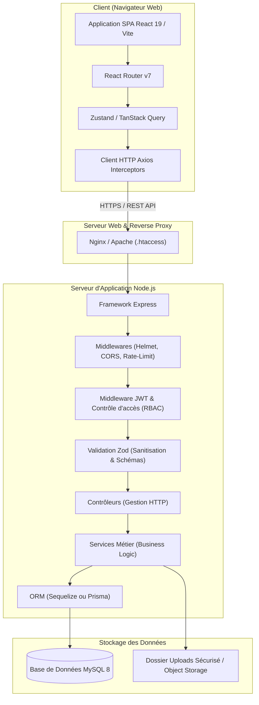
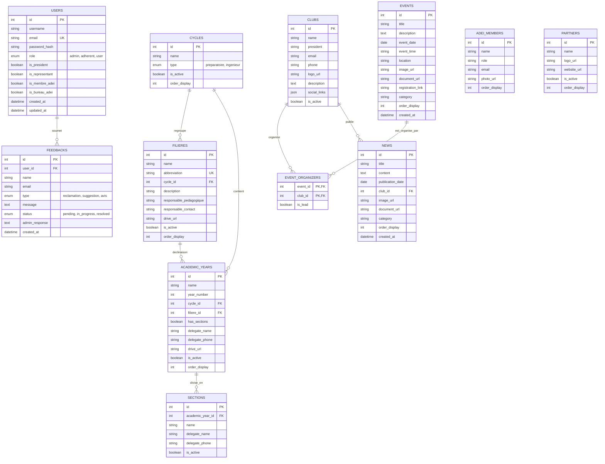

# Architecture & Feuille de Route pour la Refonte du Projet ADEI Website

> **Projet** : Portail Institutionnel, Académique & Communautaire de l'ADEI (ENSA Fès)  
> **Auteur** : Équipe Technique ADEI  
> **Statut** : Document d'Architecture & Spécifications de Refonte  
> **Date de création** : 21 Octobre 2026  

---

## Sommaire

1. [Vue d'Ensemble & Objectifs du Projet](#1-vue-densemble--objectifs-du-projet)
2. [Périmètre Fonctionnel](#2-périmètre-fonctionnel)
3. [Architecture Système & Diagrammes](#3-architecture-système--diagrammes)
   - [A. Diagramme d'Architecture Globale](#a-diagramme-darchitecture-globale)
   - [B. Diagramme Entité-Association (ERD)](#b-diagramme-entité-association-erd)
4. [Arborescence & Structure de Code Recommandée](#4-arborescence--structure-de-code-recommandée)
   - [A. Backend (Architecture en Couches)](#a-backend-architecture-en-couches)
   - [B. Frontend (Architecture par Fonctionnalités / Features)](#b-frontend-architecture-par-fonctionnalités--features)
5. [Contrats d'API & Spécifications REST](#5-contrats-dapi--spécifications-rest)
6. [Standards de Sécurité & Gestion des Secrets](#6-standards-de-sécurité--gestion-des-secrets)
7. [Feuille de Route d'Implémentation Pas-à-Pas](#7-feuille-de-route-dimplémentation-pas-à-pas)
8. [Stratégie de Déploiement & DevOps](#8-stratégie-de-déploiement--devops)

---

## 1. Vue d'Ensemble & Objectifs du Projet

La plateforme de l'**Association des Élèves Ingénieurs (ADEI)** de l'**ENSA de Fès** (`adei-ensaf.ma`) est le guichet unique digital pour :
* Faire rayonner l'école et l'association auprès des futurs étudiants, lauréats et partenaires industriels.
* Structurer la vie étudiante en centralisant les clubs, les événements et les actualités.
* Offrir un accès direct aux ressources pédagogiques et aux représentants de chaque filière/année.
* Établir un canal direct d'écoute, de réclamation et de feedback entre les étudiants et le bureau de l'ADEI.

### Pourquoi cette refonte ?
La version précédente a permis de valider les fonctionnalités mais présentait des freins majeurs :
* Un backend monolithique (`index.js` de plus de 1 500 lignes) difficile à maintenir et à tester.
* Des failles de sécurité critiques (secrets de production versionnés dans Git, dumps SQL non purgés, absence de filtrage strict sur les payloads).
* Un modèle de données incomplet (gestion des co-organisateurs d'événements incomplète, tri artificiel par permutation de dates).
* Des dettes techniques côté frontend (composants orphelins, doublons de configuration, hacks de manipulation directe du DOM).

La nouvelle version vise une **Clean Architecture**, une **sécurité stricte**, un **code testable** et un **déploiement automatisé robuste**.

---

## 2. Périmètre Fonctionnel

### A. Espace Public
* **Accueil dynamique** : Hero section avec animation typewriter, carrousels d'actualités récentes, événements à venir, statistiques d'impact et partenaires.
* **Vie Académique (ENSA Fès)** :
  * Navigation hiérarchique : Cycle Préparatoire (CP1, CP2 avec sections A, B, C) et Cycle Ingénieur (Filières GI, GTR, GC, GE, GM avec années 1, 2, 3).
  * Fiche détaillée par filière : Présentation, liens Drive / documentation, coordonnées des délégués d'année et responsables pédagogiques.
* **Clubs Étudiants** :
  * Répertoire complet des clubs avec filtres par catégorie.
  * Fiches clubs : Description, bureau/président, activités, palmarès, réunions et liens réseaux sociaux.
* **Agenda des Événements** :
  * Vue chronologique des événements passés et à venir.
  * Prise en charge des co-organisations (ex: co-organisé par ADEI et Club Informatique).
  * Modal de détails avec lien d'inscription et documents attachés.
* **Fil d'Actualités** : Articles avec catégorisation et pièces jointes.
* **Présentation ADEI** : Mission, gouvernance, trombinoscope officiel du bureau exécutif classé par ordre hiérarchique.
* **Boîte d'écoute & Feedbacks** : Formulaire public pour soumettre un avis, une proposition ou une réclamation.

### B. Espace Adhérent (Authentifié)
* **Authentification sécurisée** : Connexion par email / mot de passe.
* **Profil Utilisateur** : Modification des informations personnelles, changement de mot de passe sécurisé.
* **Badges Utilisateur** : Affichage des rôles et prérogatives (`is_president`, `is_representant`, `is_membre_adei`, `is_bureau_adei`).
* **Mes Feedbacks** : Historique des messages envoyés et notification lors de la réponse de l'administration.

### C. Console d'Administration (Back-Office RBAC)
* **Tableau de bord** : Statistiques globales (nombre d'articles, événements, clubs, réclamations en attente).
* **Gestion du Contenu (CMS)** :
  * Filières, années et sections académiques.
  * Clubs et réseaux sociaux.
  * Actualités (ordonnancement, upload d'image/document).
  * Événements (sélection multi-clubs organisateurs, lieu, date).
  * Membres du bureau ADEI (ordre d'affichage, fonction).
  * Partenaires & sponsors (activation/désactivation, ordre).
* **Gestion des Feedbacks** : Modération, changement de statut (*En attente*, *En cours*, *Résolu*), réponse officielle.
* **Gestion des Utilisateurs** : Création de comptes, réinitialisation de mots de passe, attribution des rôles et des badges.

---

## 3. Architecture Système & Diagrammes

### A. Diagramme d'Architecture Globale



---

### B. Diagramme Entité-Association (ERD)



---

## 4. Arborescence & Structure de Code Recommandée

### A. Backend (Architecture en Couches)

L'ensemble de la logique métier sort de `index.js` et est réparti selon le principe de responsabilité unique (SRP) :

```text
server/
├── config/
│   ├── database.js            # Initialisation Sequelize / Pool MySQL
│   ├── env.js                 # Validation Zod des variables d'environnement
│   └── constants.js           # Rôles, statuts, types d'événements
├── controllers/               # Extraction des paramètres & réponses HTTP
│   ├── auth.controller.js
│   ├── academic.controller.js
│   ├── clubs.controller.js
│   ├── events.controller.js
│   ├── news.controller.js
│   ├── feedbacks.controller.js
│   └── users.controller.js
├── middlewares/
│   ├── auth.middleware.js     # Vérification JWT
│   ├── role.middleware.js     # RBAC (admin, adherent)
│   ├── validate.middleware.js # Validation Zod des requêtes
│   ├── upload.middleware.js   # Multer sécurisé (validation MIME + taille)
│   ├── rateLimiter.js         # Protection anti-brute force
│   └── errorHandler.js        # Gestionnaire d'erreurs centralisé
├── models/                    # Définitions Sequelize des entités
│   ├── index.js               # Associations et relations
│   ├── User.js
│   ├── Cycle.js
│   ├── Filiere.js
│   ├── AcademicYear.js
│   ├── Section.js
│   ├── Club.js
│   ├── Event.js
│   ├── EventOrganizer.js      # Table pivot événements-clubs
│   ├── News.js
│   ├── ADEIMember.js
│   ├── Partner.js
│   └── Feedback.js
├── routes/                    # Définition des routes Express
│   ├── index.js               # Routeur maître (/api)
│   ├── auth.routes.js
│   ├── academic.routes.js
│   ├── clubs.routes.js
│   ├── events.routes.js
│   ├── news.routes.js
│   ├── feedbacks.routes.js
│   └── users.routes.js
├── services/                  # Logique métier pure (indépendante du framework HTTP)
│   ├── auth.service.js
│   ├── academic.service.js
│   ├── events.service.js
│   └── storage.service.js
├── validations/               # Schémas de validation Zod
│   ├── auth.validation.js
│   ├── event.validation.js
│   └── user.validation.js
├── .env.example               # STRICTEMENT sans secrets réels
├── app.js                     # Déclaration de l'application Express
└── server.js                  # Point d'entrée serveur (app.listen)
```

---

### B. Frontend (Architecture par Fonctionnalités / Features)

Abandonner Create React App au profit de **Vite** pour des builds instantanés et une taille de bundle maîtrisée :

```text
frontend/
├── src/
│   ├── assets/                # Logos, icônes SVG, illustrations
│   ├── components/            # Composants partagés et réutilisables
│   │   ├── common/            # Boutons, Inputs, Modales, Badges
│   │   ├── layout/            # Navbar, Footer, Sidebar admin
│   │   └── ui/                # Typewriter, ImageUpload, ThemeToggle
│   ├── config/
│   │   ├── api.js             # Instance Axios & configuration de base
│   │   └── navigation.js      # Liens de navigation
│   ├── contexts/              # États globaux légers
│   │   ├── AuthContext.jsx
│   │   └── ThemeContext.jsx
│   ├── features/              # Découpage modulaire par domaine métier
│   │   ├── academic/
│   │   │   ├── components/    # Cartes filières, sélecteur d'année
│   │   │   ├── hooks/         # useAcademicData
│   │   │   └── pages/         # Page ENSA
│   │   ├── admin/
│   │   │   ├── components/    # Tableaux de données, formulaires admin
│   │   │   └── pages/         # Dashboard, EventsAdmin, UsersAdmin...
│   │   ├── clubs/
│   │   │   ├── components/    # ClubCard, ClubFilter
│   │   │   └── pages/         # ClubsPage, ClubDetailsPage
│   │   ├── events/
│   │   │   ├── components/    # EventCard, OrganizersBadge
│   │   │   └── pages/         # EventsPage
│   │   ├── feedbacks/
│   │   │   └── pages/         # FeedbacksPage
│   │   └── home/
│   │       └── pages/         # HomePage
│   ├── hooks/                 # Hooks utilitaires réutilisables
│   ├── layouts/
│   │   ├── PublicLayout.jsx   # Header public + contenu + footer
│   │   └── AdminLayout.jsx    # Sidebar admin + contenu avec protection
│   ├── routes/                # Définition des routes React Router v7
│   │   └── AppRoutes.jsx
│   ├── styles/                # Design tokens & variables CSS
│   │   ├── theme.css
│   │   └── globals.css
│   ├── App.jsx
│   └── main.jsx
├── .env.example
├── index.html
├── vite.config.js
└── package.json
```

---

## 5. Contrats d'API & Spécifications REST

Toutes les réponses de l'API doivent adopter un format standard unifié :

```json
{
  "success": true,
  "data": {},
  "message": "Opération réalisée avec succès",
  "meta": {
    "total": 42,
    "page": 1,
    "limit": 10
  }
}
```

En cas d'erreur :
```json
{
  "success": false,
  "message": "Description claire de l'erreur pour l'utilisateur",
  "code": "VALIDATION_ERROR",
  "errors": [
    { "field": "email", "message": "Format d'email invalide" }
  ]
}
```

### Table des Endpoints Principaux

| Méthode | Endpoint | Accès | Description |
| :--- | :--- | :--- | :--- |
| `POST` | `/api/auth/login` | Public | Authentification et émission du token JWT |
| `GET` | `/api/auth/me` | Authentifié | Profil de l'utilisateur connecté avec badges |
| `POST` | `/api/auth/change-password` | Authentifié | Changement de mot de passe |
| `GET` | `/api/news` | Public | Liste des actualités (ordonnées par `order_display`) |
| `POST` | `/api/news` | Admin | Création d'actualité (avec image & document) |
| `PATCH` | `/api/news/:id/reorder` | Admin | Réordonnancement via le champ `order_display` |
| `GET` | `/api/events` | Public | Liste des événements avec clubs co-organisateurs |
| `POST` | `/api/events` | Admin | Création d'événement avec IDs multiples de clubs |
| `GET` | `/api/clubs` | Public | Liste complète des clubs |
| `GET` | `/api/academic/tree` | Public | Arborescence complète : Cycles > Filières > Années |
| `POST` | `/api/feedbacks` | Public/Auth | Soumission d'un feedback |
| `GET` | `/api/feedbacks` | Admin / Adhérent | Liste des feedbacks (filtré par utilisateur pour les non-admins) |
| `POST` | `/api/feedbacks/:id/respond`| Admin | Envoi de la réponse officielle |
| `GET` | `/api/users` | Admin | Gestion des comptes et des badges |
| `GET` | `/health` | Public | Sonde de disponibilité du service |

---

## 6. Standards de Sécurité & Gestion des Secrets

> [!IMPORTANT]
> Ces règles doivent être rigoureusement appliquées dès le premier commit de la refonte.

1. **Zéro Secrets dans Git** :
   * Le fichier `.gitignore` doit contenir :
     ```gitignore
     .env
     .env.*
     !.env.example
     *.sql
     server/uploads/*
     !server/uploads/.gitkeep
     ```
   * Utiliser des variables d'environnement distinctes pour le développement et la production, injectées via les **GitHub Secrets** lors du déploiement.

2. **Validation Strict des Données Entrantes** :
   * Chaque requête de mutation (`POST`, `PUT`, `PATCH`) doit être passée au crible par un schéma Zod.
   * Aucune assignation brute (`req.body` directement passé à l'ORM) pour éliminer les attaques par Mass Assignment.

3. **Protection de l'Authentification** :
   * Mots de passe hachés avec `bcryptjs` avec un facteur de coût minimum de 10 à 12.
   * Rate limiting strict sur `/api/auth/login` (ex: maximum 5 tentatives par tranche de 15 minutes par IP).
   * Expiration stricte des tokens JWT (ex: 24 heures).

4. **Sécurisation des Uploads de Fichiers** :
   * Vérification du type MIME réel du fichier et de son extension.
   * Limitation de taille stricte (ex: 5 Mo pour les images, 10 Mo pour les PDF).
   * Renommage systématique avec un UUID ou hash unique pour empêcher l'exécution de scripts malveillants.

---

## 7. Feuille de Route d'Implémentation Pas-à-Pas

### Phase 1 : Initialisation & Socle Architectural
- [ ] Créer le dépôt propre avec `.gitignore` exhaustif et `.env.example`.
- [ ] Initialiser le projet backend Node.js avec validation Zod des variables d'environnement.
- [ ] Configurer la connexion MySQL avec Sequelize et créer les migrations pour toutes les tables (notamment `event_organizers`).
- [ ] Initialiser le projet frontend avec **Vite + React 19**.
- [ ] Mettre en place le conteneur `docker-compose.yml` (MySQL 8 + phpMyAdmin) pour le développement local.

### Phase 2 : Authentification, Sécurité & Gestion des Utilisateurs
- [ ] Implémenter le service d'authentification (`/api/auth/login`, `/api/auth/me`).
- [ ] Mettre en place les middlewares `authMiddleware` et `adminMiddleware`.
- [ ] Configurer le client Axios frontend avec intercepteur pour l'en-tête `Authorization: Bearer <token>`.
- [ ] Créer les composants `ProtectedRoute` et les layouts `PublicLayout` et `AdminLayout`.

### Phase 3 : Modules Académiques & Clubs
- [ ] Créer l'API pour les Cycles, Filières, Années et Sections.
- [ ] Créer l'API Clubs avec upload de logo et gestion des réseaux sociaux (JSON).
- [ ] Développer la page ENSA avec navigation par cycle et détails des délégués.
- [ ] Développer la page Clubs avec filtres dynamiques et fiches détaillées.

### Phase 4 : Événements, Actualités & Co-Organisation
- [ ] Implémenter l'API des Événements gérant la table de liaison `event_organizers`.
- [ ] Implémenter l'API News avec ordonnancement propre via `order_display`.
- [ ] Créer l'interface d'administration multi-sélection pour assigner plusieurs clubs à un événement.
- [ ] Développer les vues publiques des événements avec badges des organisateurs.

### Phase 5 : Feedbacks, Espace Adhérent & Bureau ADEI
- [ ] Développer le système de soumission et de suivi des réclamations étudiantes.
- [ ] Développer le tableau de bord d'administration pour répondre aux feedbacks.
- [ ] Développer le trombinoscope de l'ADEI (ordonné par hiérarchie des postes).
- [ ] Intégrer la gestion des badges utilisateurs dans le panneau d'administration.

### Phase 6 : Tests, Optimisation & Déploiement
- [ ] Valider l'ensemble des flux sur environnement Docker local.
- [ ] Configurer le workflow GitHub Actions pour le build Vite et le déploiement FTPS sécurisé.
- [ ] Déployer en staging / test avant la mise en production officielle.

---

## 8. Stratégie de Déploiement & DevOps

* **Frontend** : Compilé en statique via `vite build` $\rightarrow$ Déployé sur l'hébergement web Apache/cPanel via FTPS avec fichier `.htaccess` pour gérer le routage SPA.
* **Backend** : Déployé via FTPS dans le dossier `/api` $\rightarrow$ Exécuté via la passerelle Phusion Passenger (`api/index.js`) ou géré via le Gestionnaire d'applications Node.js de cPanel.
* **Base de données** : Sauvegardes automatisées régulières et application des migrations Sequelize lors des déploiements.
